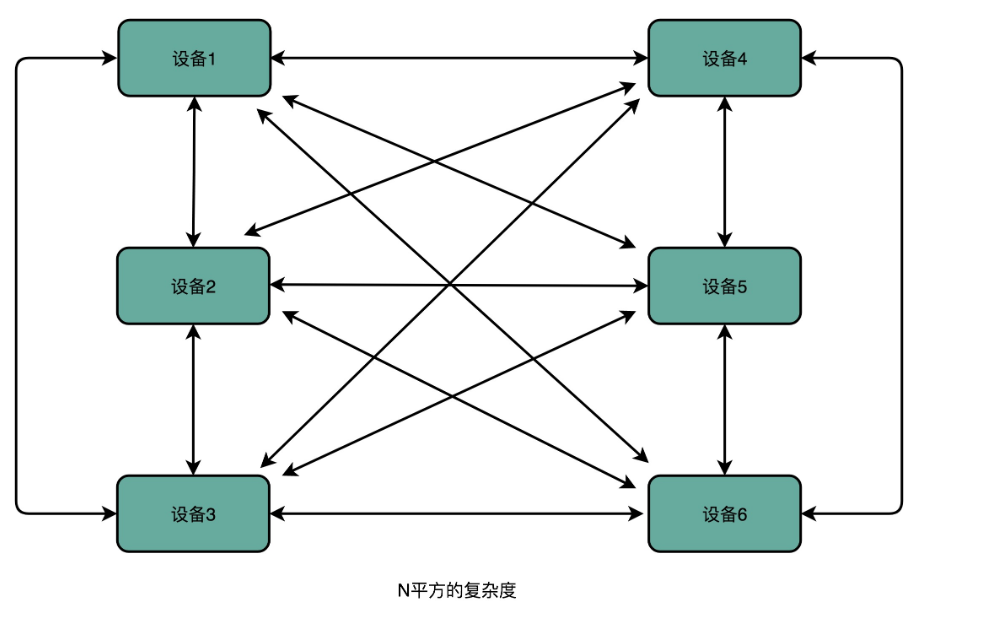
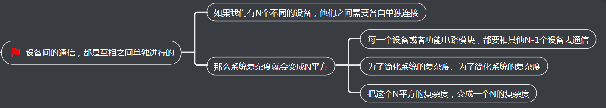
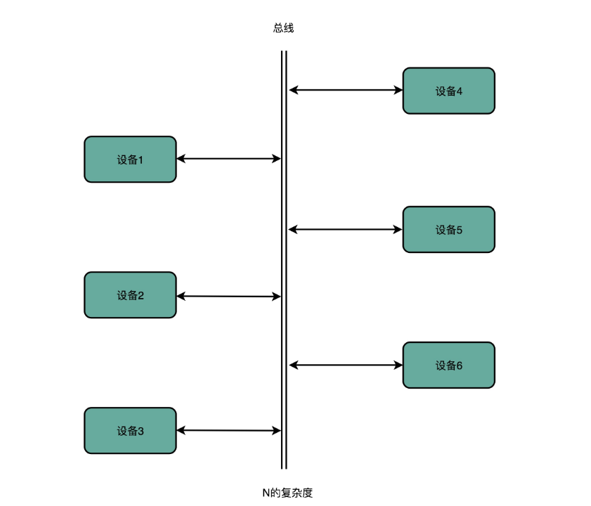
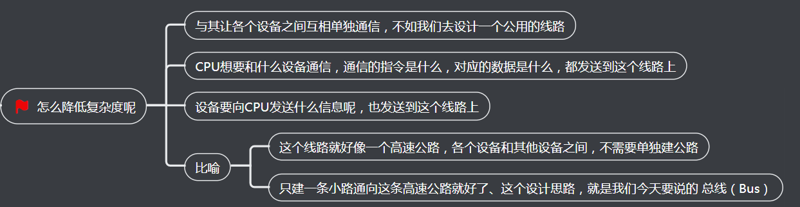
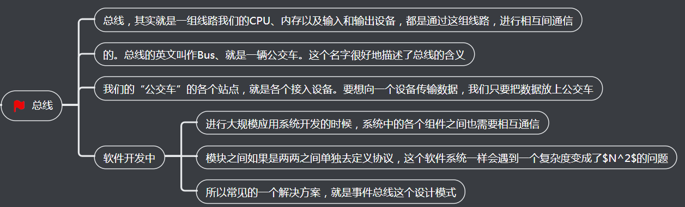
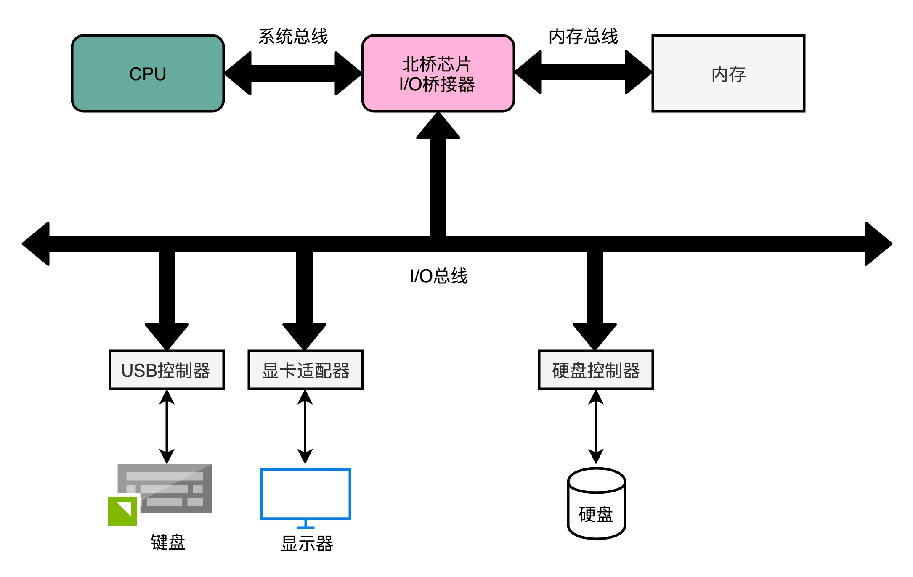
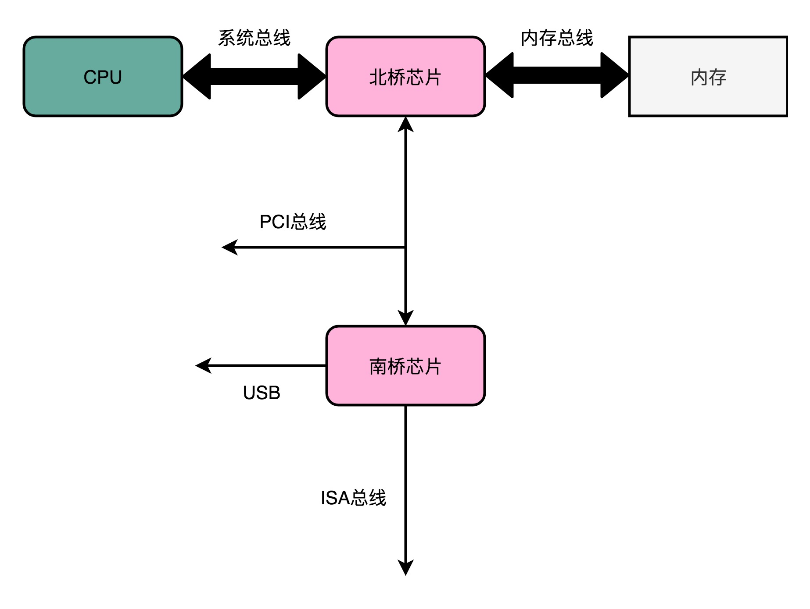
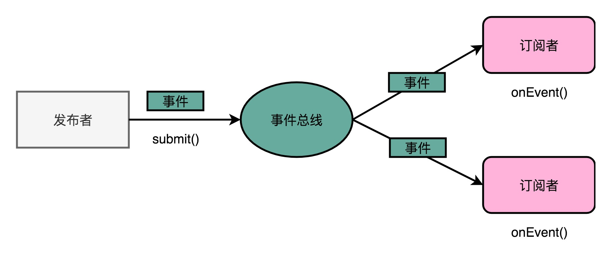
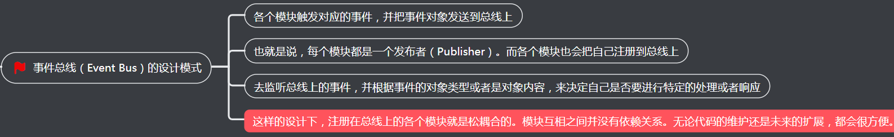

English | [简体中文](./README_CN.md)

### Ⅰ. Introduction

- [event](https://github.com/zfoo-project/zfoo/blob/main/event/README.md) The event bus is used to decouple different
  modules and improve code quality. Its core idea is the Observer design pattern.

### Ⅱ. Event bus at the hardware level

#### 1. Communication between devices

#### 2. Reduced complexity with the bus

#### 3. Multiple hardware bus architectures

The core idea behind a bus is to reduce the complexity and coupling of interactions between multiple modules.

At the hardware level, a bus is a set of wires connecting circuits.
Because different devices operate at different speeds, a computer often has multiple buses.

In software development, the same bus concept is widely applied.
The event bus is a common design pattern, often combined with the publish-subscribe pattern
to serve as a primary communication mechanism between loosely coupled modules in large-scale systems.

### Ⅲ. Event bus at the software level

- In terms of design patterns, the event bus is based on the Observer pattern.
- There is no single fixed way to implement a design pattern; zfoo event implements the event bus using simple annotations.
- zfoo event uses Javassist bytecode enhancement to dynamically proxy event receivers, avoiding reflection overhead
  and performance loss.