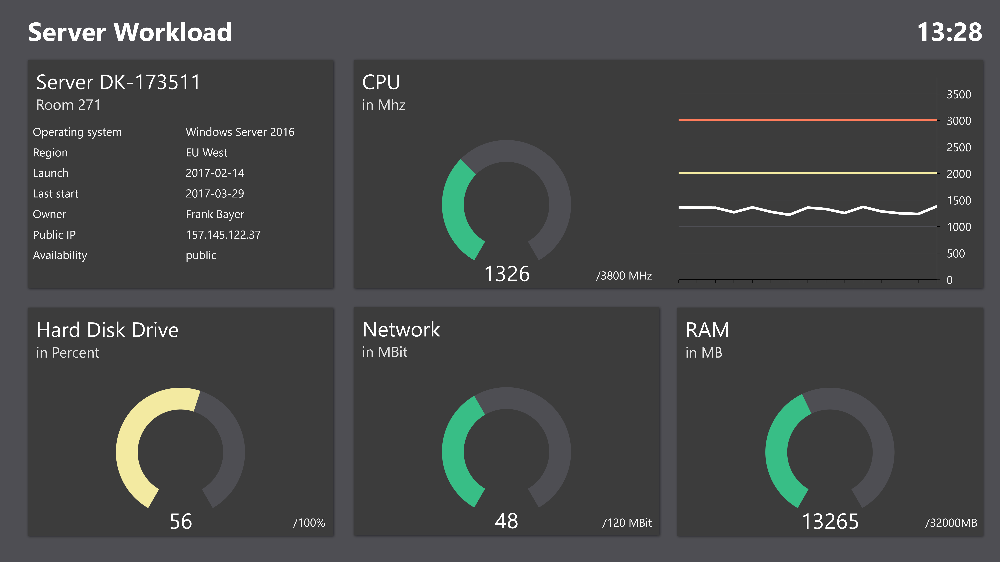

English | [简体中文](./README_CN.md)

### Ⅰ. Introduction

- [monitor](https://github.com/zfoo-project/zfoo/blob/main/monitor/README.md): Lightweight CPU, memory, disk, and
  network monitoring.

### Ⅱ. Usage

- `uptime`, modeled after the Linux `uptime` command, can be used to monitor CPU load:
  ```java
  Uptime uptime = OSUtils.uptime();
  ```

- `df`, modeled after the Linux `df` command, can be used to monitor disk space:
  ```java
  List<DiskFileSystem> df = OSUtils.df();
  ```

- `free`, modeled after the Linux `free` command, can be used to monitor memory usage:
  ```java
  Memory free = OSUtils.free();
  ```

- `sar`, modeled after the Linux `sar` command, can be used to monitor network I/O:
  ```java
  List<Sar> sar = OSUtils.sar();
  ```

### Ⅲ. Traditional Server Monitoring

- Traditional single-server monitoring mainly focuses on CPU, memory, disk, and network:
  

- Distributed server monitoring monitors multiple servers, which is not much different from single-server
  monitoring:
  ```
  It is very simple to build a distributed server monitoring system yourself.
  You only need to collect the key metrics of the current server every second or minute and upload them to a database or other servers.
  You can use the collected data to analyze performance, trigger monitoring alerts, and create line charts or other visualizations.
  Monitor metrics can be easily collected through static utility methods, allowing you to implement your own distributed monitoring program completely embedded in Java applications without additional deployment.
  ```

### Ⅳ. Modern Server Monitoring

- Today, servers are in the era of containers, and server monitoring has shifted from server monitoring to container
  monitoring.
- Container monitoring is largely an integrated feature of the container itself, and cloud vendors often provide
  monitoring tools and services for free.

### Ⅴ. Custom Server Monitoring

- Custom monitoring is the monitoring that fits your own project, such as implementing monitoring that tracks the
  number of times an RPC interface is called.
