English | [简体中文](./README_CN.md)

### Ⅰ. Introduction

- [net](https://github.com/zfoo-project/zfoo/blob/main/net/README.md) — an asynchronous, actor-based,
  lock-free, universal RPC framework with Spring MVC-style usage

1. Clean synchronous and asynchronous requests with high throughput, supporting TCP, UDP, and WebSocket
2. Service registration and discovery using ZooKeeper as the configuration center, extensible to other
   registries
3. Built-in high-performance gateway with customizable forwarding strategies
4. Scalable services, load balancing, cluster monitoring, and everything else you need

### Ⅱ. Related modules

- `net` provides two layers of API interfaces:
  - `IRouter` (low-level API): the underlying network interface that sends messages directly through a `Session`
    connection
  - `IConsumer` (high-level API): the high-level network interface wrapping `IRouter`, enabling consumers to send
    RPC messages to service providers

```
Extreme high performance, high availability, high scalability (generally refers to adding machines),
high extensibility (generally refers to the open-closed principle at the code level)

config: local configuration, ZooKeeper registration and discovery, and request load balancing
core: core package providing unified abstractions for servers and clients
router: message routing
handler: Netty handlers defining common handlers for clients and servers
protocol: message class registration, message encoding and decoding, bytecode enhancement, etc.
schema: parsing of Spring custom XML tags
session: encapsulation of Netty channels
task: task thread pool and task dispatching
```

- Network communication conventions
  - Requests from clients to servers end with `Request`, and replies end with `Response`.
  - Calls between servers end with `Ask`, and replies end with `Answer`.

On the JVM, `NetConfig.setProtocolLocations(List.of("protocol.xml", "com.example.messages"))` loads multiple protocol sources. The `protocol-locations` XML attribute accepts comma-, semicolon-, or whitespace-separated values, for example `protocol-locations="protocol.xml; com.example.messages"`. Existing classpath resources take precedence; other values are scanned as Java packages. Multiple XML resources are merged before protocol initialization, and package locations can be mixed with XML resources. Explicit XML definitions take precedence over package scanning. See [Boot protocol discovery](../boot/README.md#protocol-discovery-on-the-jvm) for the default when using Spring Boot.

#### Background

```
When developing online games in Java with complex interaction scenarios, there are a great many remote requests,
so a high-performance RPC framework is needed.

There are many RPC frameworks in the Java ecosystem, yet very few fit the requirements of game projects.
Some of them are listed below:
    dubbo: heavyweight codebase, cumbersome asynchronous calls, no gateway, cannot interact directly with clients;
    grpc: heavyweight codebase, complex to use and deploy, no gateway, difficult to customize;
    akka: uses Scala with an extremely steep learning curve, so we passed on it;

So I wrote a universal RPC framework: lightweight codebase, easy to customize, built-in gateway, inherently asynchronous, and a complete toolchain.
Through continuous optimization, I also built an ultra-fast serialization framework in Java, and performance took off from there.
Later, I realized it is useful not only for games, but for any RPC scenario with extreme performance requirements.
```

### Ⅱ. Server Architecture Diagram

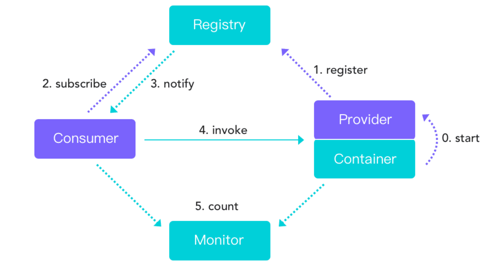

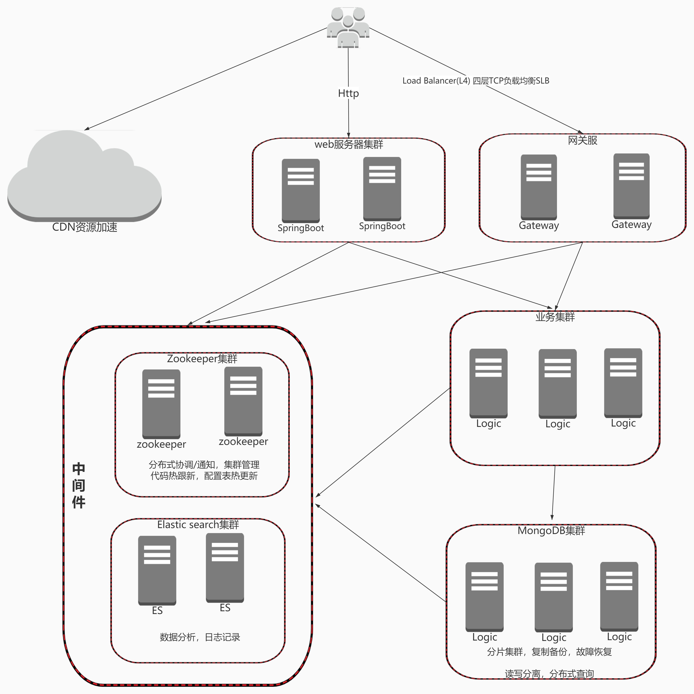<br/>

### Ⅲ. Why It's Fast
----------

- Uses the high-performance [zfoo protocol](protocol/README.md) as the serialization and deserialization protocol for
  gateway and RPC messages
- Lock-free design and an elegant thread pool architecture: user requests through the gateway are always guaranteed
  to execute on the same thread of the same server, eliminating the need for locks to handle concurrency
- RPC calls are inherently asynchronous, and callbacks after an asynchronous RPC call completes are guaranteed to execute
  on the same thread, similar to the Actor model — especially suited for scenarios with extreme performance requirements
- Uses the MVC design pattern to standardize development, ensure code quality, and execute efficiently

### Ⅳ. Server Architecture Evolution

- Single server +
  database, [zfoo net Single Server Usage Tutorial](src/test/java/com/zfoo/net/core/tcp/server/TcpServerTest.java)

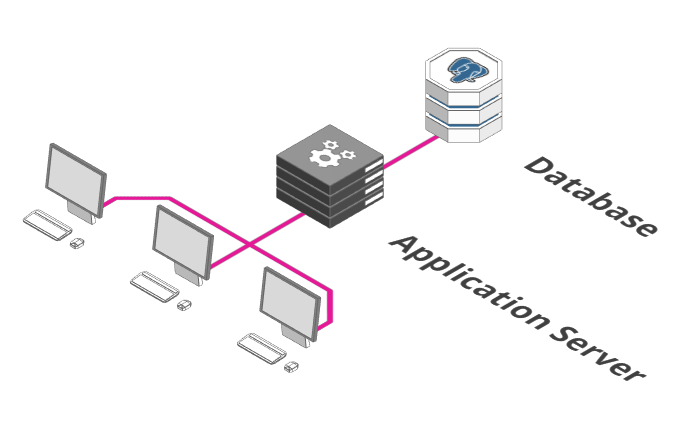

----------

- Add a reverse proxy, similar to a gateway

```
The first step in preparing for a larger-scale architecture is adding a "reverse proxy":
Routing forwards requests to the right endpoint
Health checks
Authentication ensures users are actually permitted to access the server
Firewalls ensure users can only access the parts of the network we allow them to use
```

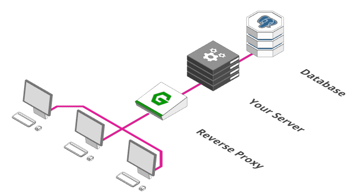

----------

- Introduce a load
  balancer, [zfoo net Gateway Load Balancing Tutorial](src/test/java/com/zfoo/net/core/gateway/GatewayTest.java)

```
The load balancer distributes requests across two servers: User 1 goes left, User 2 goes right, and User 3 goes left again.
```

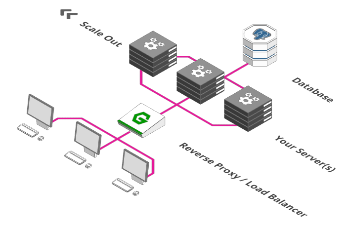

----------

- Scale out the database

```
The integrated ORM is based on MongoDB and supports distributed deployment:
MongoDB: replica set deployment (primary-secondary mode) for data synchronization and read-write separation
MongoDB: sharded deployment and failover (disaster recovery)
```

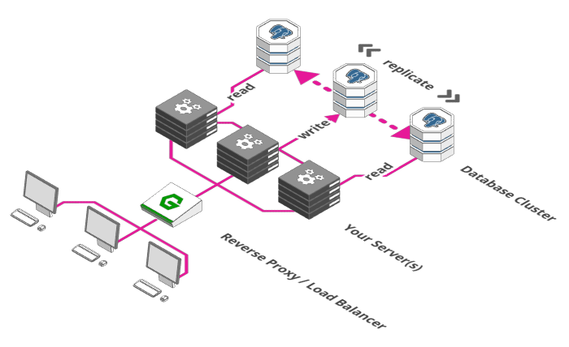

----------

- Microservices, [Microservice RPC Tutorial](src/test/java/com/zfoo/net/core/provider/ProviderTest.java)

```
As the development team grows alongside the application, more developers end up working on the same server, increasing the potential for conflicts.
At that point, splitting business domains into microservices is a better choice.

Microservices can be scaled independently to better match demand. Development teams operate independently, each owning its own microservice lifecycle.
Each microservice has its own resources, such as a database.
```

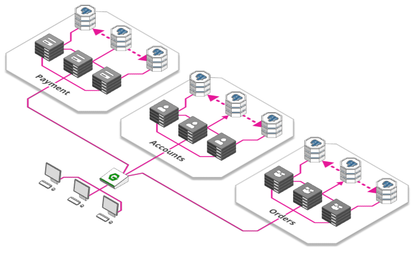

----------

- Caching and Content Delivery Network (CDN)

```
A large part of web applications consists of static resources, such as images, CSS stylesheets, JavaScript files, and pre-rendered pages for specific products.
Game applications also contain large amounts of image assets and 3D modeling resources.
An enhanced form of caching is a Content Delivery Network (CDN), consisting of caches distributed worldwide.
This allows users to fetch web content from locations physically close to them, rather than transferring data from the origin every time.
```

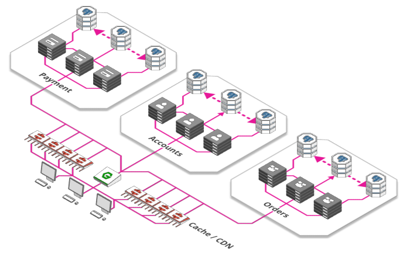

----------

- Message queue

```
During traffic spikes, such as massive Double 11 flash sales, sudden bursts of requests can be queued up for orderly processing
Application decoupling
Message distribution
```

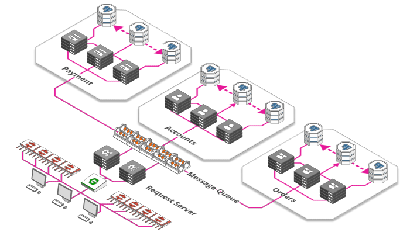

----------

- Sharding and partitioning, such as assigning users to the closest server to provide service

```
For example, multi-region active-active deployment and disaster recovery backups
```

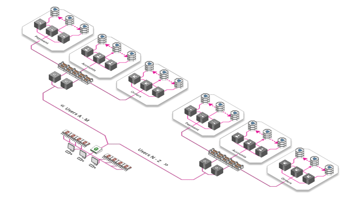

----------

- Load balancing the load balancers

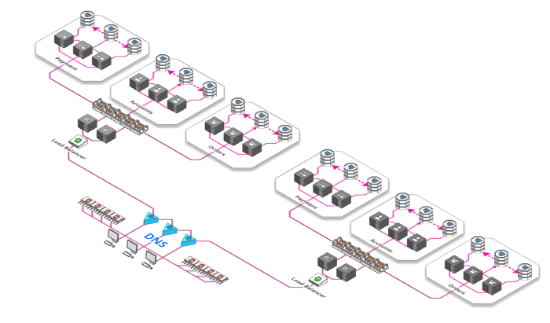

### Ⅴ. Middleware Dependency: ZooKeeper Tutorials

- [Basic ZooKeeper CRUD operations](src/test/java/com/zfoo/net/zookeeper/base)
- [Curator CRUD operations](src/test/java/com/zfoo/net/zookeeper/curator)
- [Distributed auto-incrementing ID implemented with ZooKeeper](src/test/java/com/zfoo/net/zookeeper/recipes/atomicint)
- [Distributed barrier](src/test/java/com/zfoo/net/zookeeper/recipes/distributedbarrier)
- [Distributed locks](src/test/java/com/zfoo/net/zookeeper/recipes/distributedbarrier)
- [Data publishing and subscription](src/test/java/com/zfoo/net/zookeeper/recipes/nodecache)
- [ZooKeeper's distributed leader election algorithm](src/test/java/com/zfoo/net/zookeeper/recipes/mastersel)

### Ⅵ. Reference

- [Scaling webapps for newbs](https://arcentry.com/blog/scaling-webapps-for-newbs-and-non-techies/)
