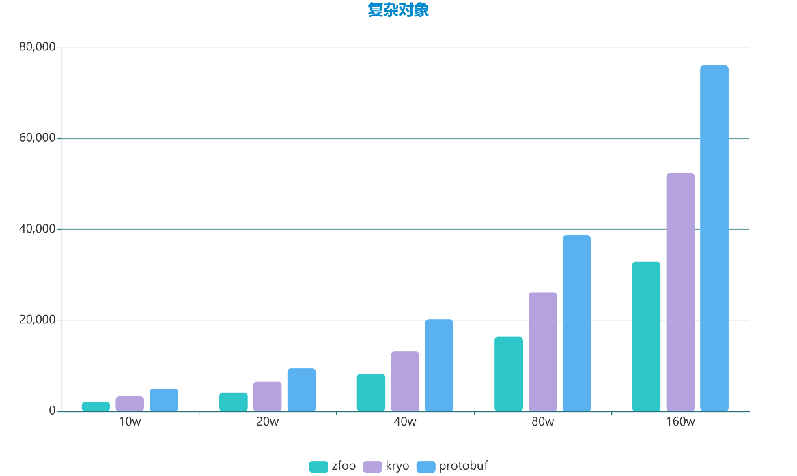

English | [简体中文](./README_CN.md)

### Ⅰ. Introduction

- A decentralized network serialization library: secure, reliable, with customizable private protocol formats and backward and forward compatibility, allowing everyone to have a unique set of protocols
- Supports generating POJO protocol files from Protobuf `.proto` files; the generated protocols can be converted to other protocols and used in Java
- Currently natively supports **C++ Rust Java/Kotlin/Scala JavaScript/TypeScript/ES C# Go PHP Ruby Lua GDScript Python Dart Swift**

### Ⅱ. Quick Start

- Environment requirement: **JDK 17+**, supporting **OpenJDK**, **Oracle JDK**, and **native GraalVM**

```
// Register the zfoo protocol; it can only be initialized once
ProtocolManager.initProtocol(Set.of(ComplexObject.class, ObjectA.class, ObjectB.class));

// Serialization
ProtocolManager.write(byteBuf, complexObject);

// Deserialization
var packet = ProtocolManager.read(buffer);
```

### Ⅲ. Performance Testing

- [Benchmark Test](src/test/java/com/zfoo/protocol/BenchmarkTesting.java)

- Test environment

```
system: win10
cpu: i9900k
memory: 64g
```

- Single-threaded test, where the x-axis represents the number of serialized and deserialized objects and the y-axis represents the time spent in milliseconds
  
  
  

### Ⅳ. Why It Is Fast

- Uses Javassist bytecode enhancement to dynamically generate sequential serialization and deserialization functions, which can be easily JIT-compiled to achieve extreme performance
- Natively integrated with Netty's high-performance ByteBuf, supporting Zero Copy
- Uses primitive type collections to avoid boxing and unboxing, eliminating unnecessary GC and delivering high performance
- Inherently thread-safe and lock-free, with no performance loss in multi-threaded environments
- No reflection, no unsafe operations, and supports GraalVM
- Flattens method stack call depth so nested data structures (such as `List<Set<Map<>>>`) incur no performance penalty, unlike Kryo and Protobuf
- No risk of vulnerability injection: bytecode enhancement is performed only during initialization, with no further bytecode operations afterwards
- Takes advantage of program locality by storing serializers in a `short[]` array, so object serialization and deserialization look up the serializer only once

```
Small compressed data size, smaller than both Kryo and Protobuf (smaller than Kryo because Kryo needs to write the registration ID of each object)
Intelligent syntax analysis: invalid protocol definitions prevent the program from starting and emit error warnings
Improves development efficiency with full POJO development support and ease of use
```

### Ⅴ. Why It Is Small

- Lightweight implementation, with around a thousand lines of core serialization and deserialization code
- Optimized zigzag and varint encoding algorithms for int and long, avoiding redundant method calls and bit operations
- Small compressed data size, smaller than both Kryo and Protobuf (smaller than Kryo because Kryo needs to write the registration ID of each object)
- Intelligent syntax analysis: invalid protocol definitions prevent the program from starting and emit error warnings
- Improves development efficiency, fully supports POJO development, and is very easy to use

```
The current sizes of serialized objects are as follows:
Simple object: zfoo packet size 8, kryo packet size 5, protobuf packet size 8
Normal object: zfoo packet size 430, kryo packet size 483, protobuf packet size 793
Complex object: zfoo packet size 2216, kryo packet size 2528, protobuf packet size 5091
```

### Ⅵ. Data Types

- Built-in data format support eliminates the need for manual registration. [Reference class definition](src/test/java/com/zfoo/protocol/packet/ComplexObject.java)
    - boolean, byte, short, int, long, float, double, String
    - Boolean, Byte, Short, Integer, Long, Float, Double, String: if null during serialization, a default value will be assigned
    - int[], Integer[]: if null, parsed as an array of length 0
        - Native generic List, Set, Map: deserialization returns HashSet, ArrayList, HashMap, and is null-pointer safe (returns a collection of size 0)
        - List<Integer>: a generic type must be specified; if [1,1,null,1] is sent, [1,1,0,1] is received
        - List<XXXClass>: if [obj,obj,null,obj] is sent, [obj,obj,null,obj] is received—that is, reference types that are null before serialization remain null after deserialization

- Unsupported data formats (zfoo automatically detects unsupported types and emits error warnings, so users don't need to worry about them):
    - int[][]: arrays with two or more dimensions, considering that not all languages support multidimensional arrays
    - List<Integer>[], Map<Integer, Integer>[]: Java itself does not support arrays of generic types
    - List<int[]>, Map<Integer, Integer[]>: arrays nested inside generics look awkward and are rarely used in practice
    - char or Character: many other languages do not support char; it can be replaced with String
    - Enum classes: many other languages do not support enum classes; they can be replaced with int or String
    - Custom generic class XXXClass<T>: generic classes are prone to performance and parsing problems in many frameworks, and are not supported in all languages
    - Circular references: although supported at the lower level, circular references are semantically hard to understand and error-prone, so they are blocked

### Ⅶ. Protocol Specifications

- The protocol class must be a simple JavaBean that does not inherit from any other class, though it can implement interfaces

- The protocol ID is defined as a short type to reduce packet size and memory usage: each packet saves 2 bytes, and application memory for each protocol is reduced by 6 bytes (protocols + IProtocolRegistration + protocolIdMap)

```
A project's protocol classes rarely exceed 30,000, and tools are provided to automatically pack your protocol IDs more compactly so they will not exceed 30,000.
```

- There are four ways to specify the protocol ID for a protocol class:
    - First: using the annotation `@Protocol(id = protocolId)`
      ```
      @Protocol(id = 104)
      public class SimpleObject {
      
          public int c;
          public boolean g;
      
      }
      ```

    - Second: registering protocols via `ProtocolManager.initProtocolAuto()` without explicitly writing protocol IDs
      ```
      public class SimpleObject {
      
          public int c;
      
          public boolean g;
      
      }
      ```

    - Third: registering protocols via `ProtocolManager.initProtocol(xmlProtocols)` with protocol IDs defined in the `protocol.xml` file
      ```
      <protocols>
          <!-- Use class path -->
          <module id="1" name="common">
              <protocol id="100" location="com.zfoo.protocol.packet.ComplexObject"/>
              <protocol id="101" location="com.zfoo.protocol.packet.NormalObject"/>
              <protocol id="102" location="com.zfoo.protocol.packet.ObjectA"/>
              <protocol id="103" location="com.zfoo.protocol.packet.ObjectB"/>
              <protocol id="104" location="com.zfoo.protocol.packet.SimpleObject"/>
              <protocol id="105" location="com.zfoo.protocol.packet.VeryBigObject"/>
              <protocol id="106" location="com.zfoo.protocol.packet.EmptyObject"/>
          </module>
          <!-- Using a package name scans all protocol classes under that package path -->
          <module id="2" name="native">
              <protocol location="com.zfoo.net.packet.common"/>
              <protocol location="com.zfoo.tank.common.protocol.common"/>
          </module>
      </protocols>
      ```   

    - Fourth: generating protocols with protocol IDs by defining a `.proto` file for easy registration
      ```
      syntax = "proto3";
      package test.message;
    
      message SimpleObject {
          int64 aa = 1;
      }
    
      // If the tag of a field exceeds 1000, the field is considered to be a compatible protocol field
      message OneMessage {
          // This is a comment on the field
          int64 id = 1;
          // This is equivalent to adding a @Compatible annotation to this field
          string name = 1001;
      }
      ```

- If you add a field for version compatibility, you need to add a `@Compatible` annotation, and its order must increase sequentially so that old and new protocols remain compatible with each other; nested protocols also remain compatible
- To maintain version compatibility, avoid renaming fields: by default, fields are read and written in the natural lexicographical order of their names (this can also be customized), so renaming a field will cause serialization exceptions
- In production, avoid removing fields for version compatibility—there is no need to delete an unused field, so reducing fields is not supported
- Among the six principles of design patterns, the Open-Closed Principle states that entities should be open for extension and closed for modification. Protocol design should follow this principle as well, prioritizing adding new protocols over modifying existing ones

### Ⅷ. Differences Between zfoo and Protobuf

- Protobuf allows deleting fields, whereas zfoo does not support deleting fields, trading that off for 2x performance and half the packet size

```
In fact, in production projects it is very rare to delete a field. If a field is deleted, both the server and the client have to update their code to stop referencing it, doubling the workload.
If either side forgets to update its code, errors will occur immediately. Therefore, marking an obsolete field with @Deprecated in actual projects avoids a lot of unnecessary trouble.
```

- zfoo takes the intersection of type declarations across all languages rather than Protobuf's union, simplifying Protobuf's type implementation
    - protobuf
      ```
      double
      float
      int32
      int64
      uint32
      uint64
      sint32
      sint64
      fixed32
      fixed64
      sfixed32
      sfixed64
      bool
      string
      bytes
      bytes
      ```
    - zfoo
      ```
      float
      double
      byte
      int16
      int32
      int64
      bool
      string
      ```

- zfoo takes the intersection of syntax across all languages rather than Protobuf's union, while extending Protobuf's syntax support
    - protobuf
      ```
      Collection nesting syntax is not supported
      ```
    - zfoo
      ```
      Nested collection syntax is supported
      ```

- Simplified Protobuf syntax: no enums, no oneof, and no optional
