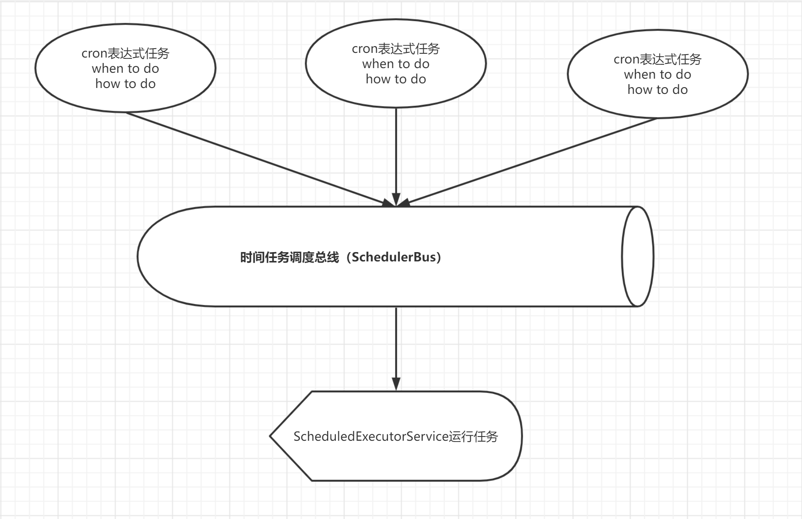

English | [简体中文](./README_CN.md)

### Ⅰ. Introduction

- [scheduler](https://github.com/zfoo-project/zfoo/blob/main/scheduler/README.md) is a scheduled task bus; cron
  expression parsing uses Spring's built-in interpreter pattern.

### Ⅱ. Task Scheduling



- Adjusting the local machine clock forward or backward updates task scheduling, which is very useful for local
  development.
- `ScheduledExecutorService` executes `SchedulerBus.triggerPerSecond()` once every second, iterating through all
  ready schedulers.
- zfoo assumes an application does not have many scheduled tasks, so `ScheduledExecutorService` uses only a single
  thread. Users should avoid time-consuming or blocking operations and offload them to another thread pool if needed.
- zfoo scheduler uses Javassist bytecode enhancement to dynamically proxy scheduled tasks, avoiding reflection overhead
  with no performance loss.

### Ⅲ. Cron Expression Examples

```
30 * * * * ?           Task is triggered at 30 seconds past every minute
30 10 * * * ?          Task is triggered every hour at 10 minutes and 30 seconds
30 10 1 * * ?          Task is triggered every day at 01:10:30
30 10 1 20 * ?         Task is triggered on the 20th of every month at 01:10:30
30 10 1 20 10 ? *      Task is triggered every year on October 20 at 01:10:30
30 10 1 20 10 ? 2018   Task is triggered on October 20, 2018 at 01:10:30
30 10 1 ? 10 * 2018    Task is triggered every day in October 2018 at 01:10:30
30 10 1 ? 10 SUN 2018  Task is triggered every Sunday in October 2018 at 01:10:30
15,30,45 * * * * ?     Task is triggered at 15, 30, and 45 seconds of every minute
15-45 * * * * ?        Task is triggered every second from 15 to 45 seconds of every minute
15/5 * * * * ?         Task starts at 15 seconds past every minute and triggers every 5 seconds
15-30/5 * * * * ?      Task triggers every 5 seconds between 15 and 30 seconds past every minute
0 0/3 * * * ?          Task starts at minute 0, second 0 of every hour and triggers every 3 minutes
0 15 10 ? * MON-FRI    Task is triggered once a day from Monday to Friday at 10:15:00
0 15 10 L * ?          Task is triggered on the last day of every month at 10:15:00
0 15 10 LW * ?         Task is triggered on the last weekday of every month at 10:15:00
0 15 10 ? * 5L         Task is triggered on the last Thursday of every month at 10:15:00
0 15 10 ? * 5#3        Task is triggered on the third Thursday of every month at 10:15:00
```
