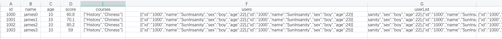
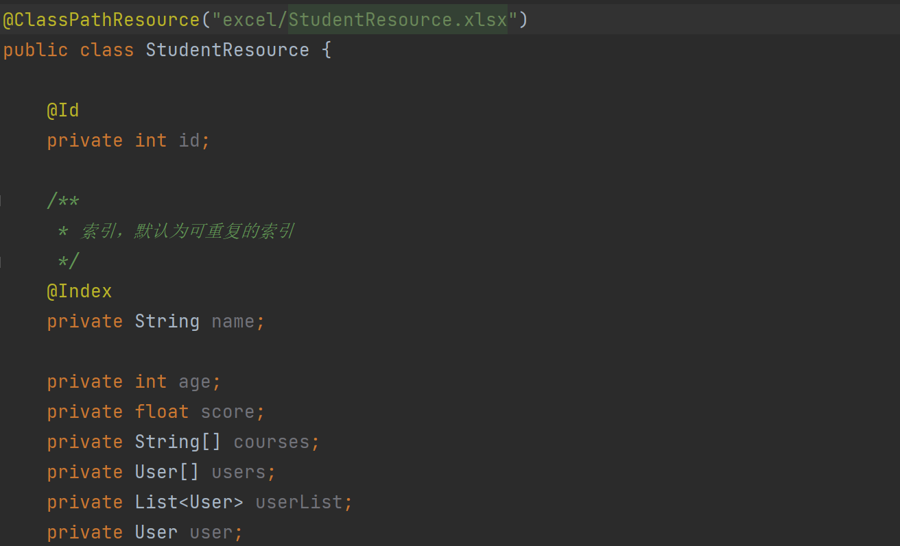
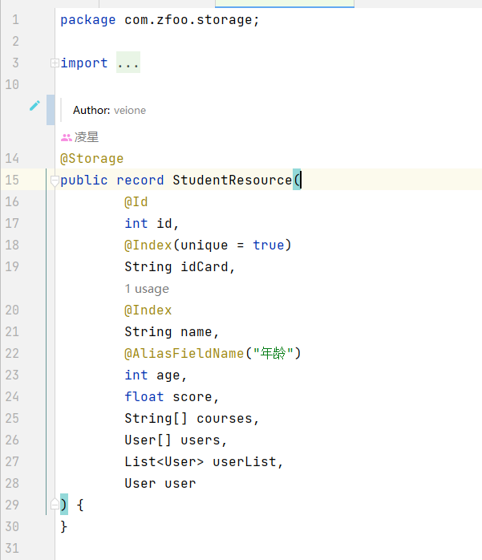

English | [简体中文](./README_CN.md)

### Ⅰ. Introduction

- [storage](https://github.com/zfoo-project/zfoo/blob/main/storage/README.md) is a Java POJO and Excel/CSV/JSON
  automatic mapping framework. You only need to define a class corresponding to an Excel sheet to directly parse
  Excel, JSON, and CSV files.

- Leverages Java's reflection capabilities to parse Excel files with no parsing code required.

- Null-safe for arrays and collections: empty arrays or collections are parsed as zero-length arrays or empty collections.

- Empty strings are parsed as zero-length strings, and empty objects are parsed as null.

- Supports exporting Excel files to JSON and CSV.

### Ⅱ. Automatic Mapping

- The first row of an Excel sheet corresponds to the Java class fields, the second and third rows do not serve as
  comments, and the first column must be the Id field.



- The corresponding Java class for Excel



- You can also use a Java record class:



- After parsing, there are two ways to access the data:
  1. By annotation
  ```
   @Component
   public class StudentManager {

    @ResInjection
    private IStorage<Integer, StudentResource> studentResources;

    }
  ```
  2. Dynamically retrieved by class
  ```
  IStorage<Integer, StudentResource> studentResources = StorageContext.getStorageManager().getStorage(StudentResource.class);
  ```

- Find a row by id:

```
var studentResource = studentResources.get(1000);
```

Alternatively, it can be retrieved as follows:

```
var resource = StorageContext.get(StudentResource.class, 1001);
```

- Find rows by index (non-unique by default, returning a list):

```
var students = studentResources.getIndex(StudentResource::getName, "james0");
```

If using a record class, the usage is as follows:

```
var students = studentStorage.getIndexes(StudentResource::name, "james0");
```

- A unique index is retrieved via Storage.getUniqueIndex(), and the index annotation must be marked as @Index(
  unique = true):

```
StudentResource student = storage.getUniqueIndex(StudentResource::idCard, "110101200007281903");
```

### Ⅲ. Hot Reloading Excel / JSON

- [tank](https://github.com/zfoo-project/tank-game-server/blob/main/common/src/main/java/com/zfoo/tank/common/util/HotUtils.java)
  Implementation of distributed hot reloading for Excel, JSON, and CSV configuration files

### Ⅳ. Use Cases

- Financial analysis and statistical data processing
- Game data and numerical configuration
